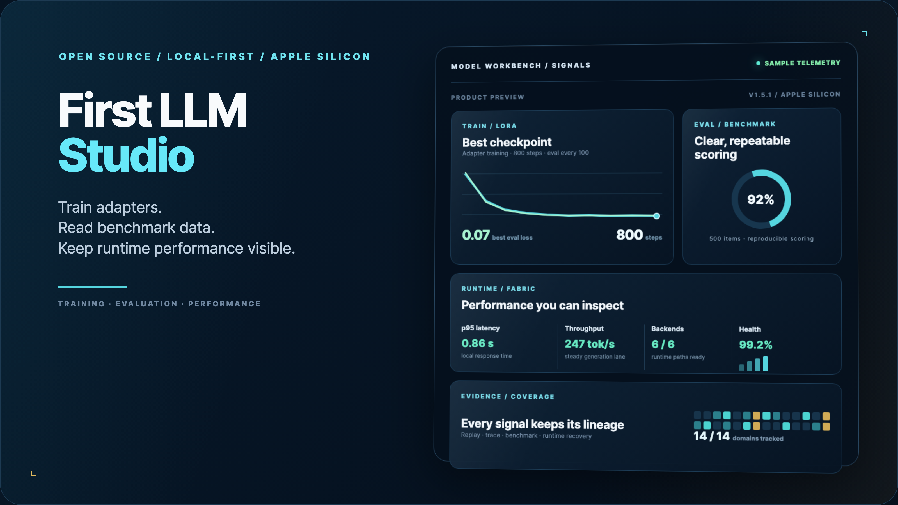
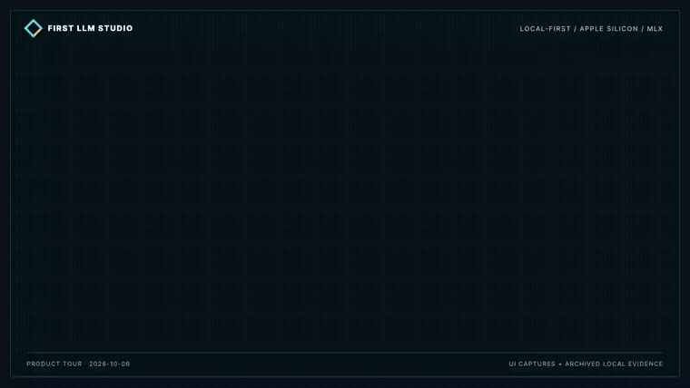
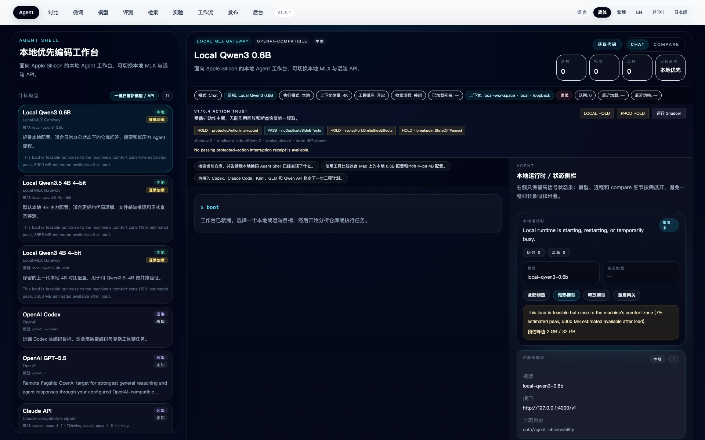
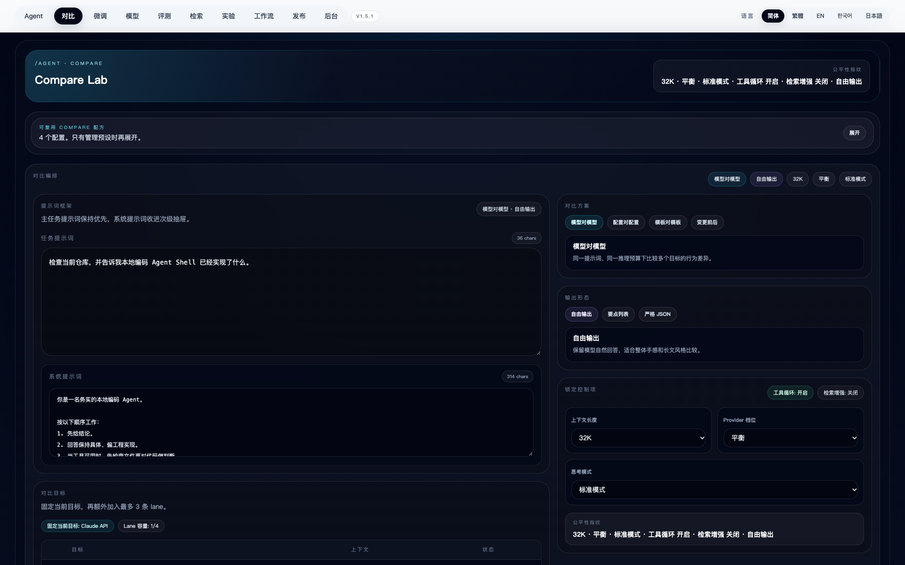
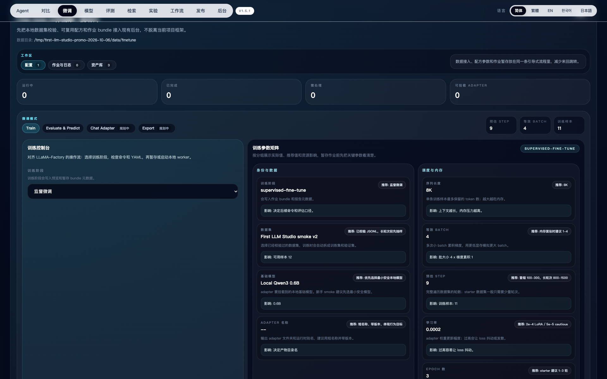
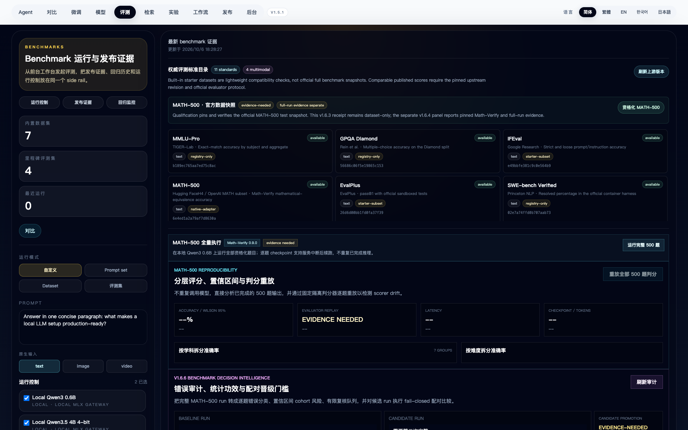
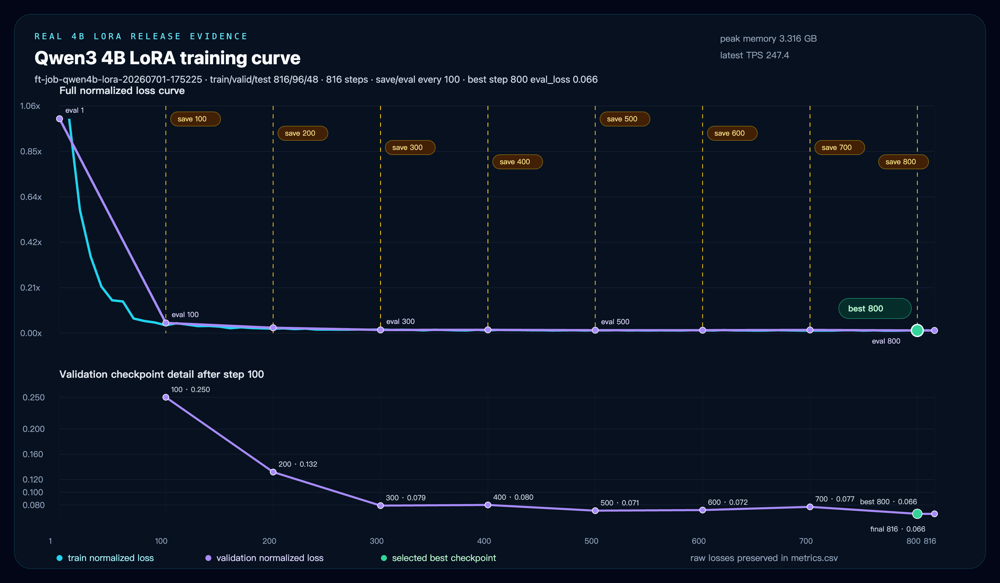
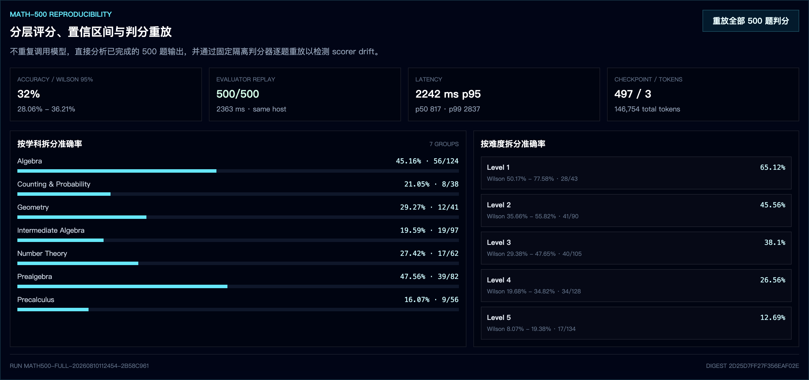

# First LLM Studio

[English + 简体中文 README](./README.md)


<p align="center">
  <a href="https://github.com/ChrisChen667788/Your-First-LLM-Studio">
    
  </a>
</p>

> 主视觉中的数据为产品宣传用示例遥测；真实工作流与发布证据以项目文档为准。

## 产品短片

<p align="center">
  <a href="./docs/assets/product-tour/first-llm-studio-promo.mp4">
    
  </a>
</p>

[观看约 22 秒无声短片](./docs/assets/product-tour/first-llm-studio-promo.mp4) · [当前实机界面](./docs/product-tour-and-positioning-2026-10-06.md#current-product-media--当前产品素材) · [分镜与素材来源](./docs/product-tour-and-positioning-2026-10-06.md#short-film--宣传短片)

从模型选择到可复查证据：用一个本地优先工作台串起 Agent、对比、微调、评测与运行时操作。短片混合当前隔离环境界面与**明确标注的历史本地** LoRA、MATH-500 证据，不代表连续实机任务、客户成效或生产验收。

---

最新开发批次：[v5.8.0-v5.9.4 激活运营](./docs/v5.8.0-v5.9.4-activation-operations-plan-2026-09-10.md)。在签名接收之上增加运营策略与信任快照、权威密钥轮换、时效与冲突投影、隔离租约、审阅门槛、决策一次性接收、不授权分发/生产防火墙，以及不含密钥的审计导出/合并。默认服务仍未配置，分发为 `HOLD`，生产为 `BLOCKED`。[操作说明](./docs/activation-operations-operator-guide.md)。

最新开发批次：[v5.6.0-v5.7.4 签名证据接收](./docs/v5.6.0-v5.7.4-activation-intake-plan-2026-09-09.md)。已接入真实 Ed25519 验签、服务端公钥固定、角色与受众绑定、原子导入/预检、持久化重放防护、独立证据配对、续期/撤销、签名隔离处理和重新验签备份合并。Experiments 收件箱与 CLI 共用应用服务。以上为源码里程碑，组织证据仍待提供，分发/生产保持 HOLD/BLOCKED。[操作说明](./docs/activation-intake-operator-guide.md)。

First LLM Studio 是一个面向 Apple Silicon 的本地优先 LLM 工作台。它把本地 MLX 运行时、远端 API 目标、Agent 会话、Compare 对比、Fine-tune 微调、Benchmark 评测、模型发现、runtime 恢复、发布证据和后台监控统一到一个产品界面里。

它不是另一个聊天壳，而是给真正需要比较模型行为、调试 runtime、跑评测、准备 adapter，并把本地/远端模型工作流收在同一个产品循环里的开发者使用。

## 产品入口

| 路由 | 核心工作流 |
| --- | --- |
| `/agent` | 带工具循环的 Agent 会话、target 选择、runtime 状态、replay、trace review，以及内嵌 Compare 入口。 |
| `/compare` | 前台 Compare Studio，负责 prompt 编排、lane preview、recipe 持久化、review drawer 和 benchmark handoff。 |
| `/fine-tune` | 前台 Fine-tune Studio，覆盖数据集、配方、训练、评估、adapter proof loop、导出、报告和 artifacts。 |
| `/models` | 本地/社区模型发现、安装验证、硬件适配和风险提示。 |
| `/benchmarks` | Benchmark run controls、进度、报告、发布证据、baseline 和回归审阅。 |
| `/retrieval` | 本地知识导入、chunk 检查、权限过滤、引用与 grounded query 验证。 |
| `/experiments` | 统一查看 session/run 时间线、产物来路、跨模块跳转与证据门禁。 |
| `/admin` | Runtime、队列、benchmark 历史、provider health、guardrails 和 audit timeline 的监控/配置镜像。 |

## 大版本核心功能

| 版本 | 核心功能 |
| --- | --- |
| `v0.1` 基础版 | 建立本地优先 Web Studio、Apple Silicon/MLX 网关工作流、本地 + 远端 target catalog、runtime telemetry，以及 Agent/Admin 的第一版操作分层。 |
| `v0.2` Agent + Benchmark 运维 | 增强 Agent 工作台、Compare 式 target review、replay/trace 检查、runtime recovery controls、正式 benchmark 运维、baseline 和回归证据。 |
| `v0.3` Fine-tune + 发布证据 | 加入 evaluation、adapter chat、adapter export、distillation starter 等 fine-tune 操作循环；扩展 operation history、分区 typecheck、截图 smoke、route smoke 和公开发布素材。 |
| `v0.4` 产品信息架构里程碑 | 把 `/fine-tune`、`/compare`、`/models`、`/benchmarks` 推进为前台产品路由；迁移 feature-owned state/actions；统一 studio/workbench 视觉；API route 变薄 application wrapper；Admin 收口为监控/配置。 |
| `v0.4.1` 稳定基线 | 修复 dataless 工作区导致的启动/编译卡死，保持 route smoke 和 typecheck 通过，刷新 OpenAI-compatible `/v1` 接口、provider 状态回报和当前实机 UI 证据。 |
| `v0.4.2` 证据补丁 | 正式固化 GitHub/ModelScope 高清截图同步、README 截图 LFS 阈值修复，并保留 v0.4.1 真实 LoRA 发布证据作为稳定公开基线。 |
| `v0.5` Starter 轨道 | 企业 RAG、部署 registry、OpenAI-compatible API、telemetry、release-readiness gates、生产签收和 control-plane rehearsal 持续放在显式 preview gate 后推进，满足证据门槛后再 promotion。 |
| `v1.0` 一体化 GA 基线 | 统一 Agent、Compare、Model Hub、Retrieval、Fine-tune、Benchmark、Experiments、Admin 监控、thin application API、route ownership、release security 与可复现证据契约。 |
| `v1.1.0-rc.1` 桌面首次启动 | 加入自包含 Apple Silicon app、内置 Node、ZIP/DMG、首次诊断、权限与服务恢复、迁移/更新/回滚/卸载演练、真实 Ollama 本地对话证明和 clean-profile 启动证据；Developer ID notarization 继续作为独立 GA 门禁。 |
| `v1.1.0-rc.2` 桌面分发门禁 | 将 shell 入口替换为原生 arm64 launcher，并加入内部代码/app/DMG 分层签名、双层公证日志、staple/Gatekeeper 验证、独立 Mac 验收脚本及带线下信任锚的 RSA 组织签收；真实外部 receipt 仍是 GA 门禁。 |
| `v1.1.1` Model Hub 生命周期 | 加入不可变多文件 Hub manifest、provider SHA-256 receipt、operator-approved 物理外置盘迁移、ownership manifest 和可视 promotion read model；更新后的 Hub identity receipt 仍是独立门禁。 |
| `v1.2.0` Local Server 验收 | 加入真实 Ollama 15-slice 验收，覆盖进程健康、模型驻留、OpenAI-compatible chat/SSE、并发、计量、访问策略、日志保留、idle eviction 和 unload/reload recovery；跨设备 LAN 与持续 daemon 证据继续作为生产门禁。 |
| `v1.2.1` Runtime Fabric | 用同一标准化合同实现 MLX、Ollama、llama.cpp、LocalAI、vLLM 与 SGLang 适配器；Apple Silicon 上真实 MLX/Ollama/llama.cpp chat 与 SSE 全部通过，硬件或端点不满足时会在执行前给出可操作错误码；外部 LocalAI、Linux/NVIDIA 与异构节点 receipt 继续作为生产门禁。 |
| `v1.3.0` MCP + 安全扩展 | 加入固定版本 MCP server registry、真实 stdio capability discovery、Ed25519 签名安装/升级/回滚、权限与密钥 scope、quarantine、依赖/路径防御及 macOS Seatbelt 强制隔离；本地验收 11/11 PASS，独立 publisher、Linux/Windows sandbox 与远程 OAuth receipt 继续作为生产门禁。 |
| `v2.1.x` Post-GA 运维证据 | 加入连续性、SLO、事故、数据、访问、供应链、质量、容量、灾备和独立复核的只读外部签名链；只能验证，不能操作或授权生产。 |
| `v2.2.x` 持续 Assurance | 加入合规范围、隐私、模型风险、第三方、监管映射、透明度、Responsible UX、资源效率、整改和独立复核的严格外部签名合同。 |
| `v2.3.0-v2.3.4` Assurance 闭环 | 加入证据迁移回读、Trust Center 发布、持续监控、独立审计整改和不可变闭环归档验证；外部证据保持 `HOLD`，生产保持 `BLOCKED`。 |
| `v2.4.0-v2.5.4` 运行与部署生命周期 | 把 Runtime、Provider、成本、Benchmark、Retrieval、Agent、Workflow、Fine-tune 与部署可移植性、主权、密钥、连续性连接成 source-backed 证据链。 |
| `v2.6.0-v2.7.4` 受治理自治与开放互操作 | 覆盖模型选择、Provider 路由、Grounded Context、工具权限、受保护动作、质量、Adapter 回滚、OpenAI-compatible、MCP、产物与身份可移植性。 |
| `v2.8.0-v2.8.9` 运行整改与效率 | 把 Provider、Retrieval、模型供应链、Workspace 审计、Runtime、Agent、Workflow、Benchmark 与 Fine-tune 的真实 owner 信号整理为有优先级的整改链。 |
| `v2.9.0-v2.9.4` 可持续运行与升级 | 增加遥测/资源透明度、故障诊断与保留、Admin compatibility sunset、桌面升级/数据生命周期及独立闭环。 |
| `v3.0.0-v3.0.9` 整改控制面 | 把 7 个未闭环 owner 信号转换为带优先级、依赖、验收条件、下一动作、证据指纹、确定性打包与独立签收的控制项。 |
| `v3.1.0-v3.1.4` 服务就绪 | 增加客户安全的就绪披露、支持诊断、升级变更连续性、运行交接看板和独立闭环，同时保持生产授权独立。 |
| `v3.2.0-v3.2.9` 整改执行 | 把 7 个 owner 控制项转换为带确定性幂等、短租约、围栏、回滚、证据打包和独立执行签收的非变更执行计划。 |
| `v3.3.0-v3.3.4` 运营验收 | 增加 SLO/质量策略、事故/变更演练、身份绑定 owner 签收、显式发布决策和前序绑定的独立运营验收。 |
| `v3.4.0-v3.4.9` Owner 工作负载准入 | 为 7 类 owner 工作负载增加严格摘要绑定请求、只读准入、受限 SLA/升级、候选回执校验和独立回执闭环。 |
| `v3.5.0-v3.5.4` 运营决策治理 | 增加证据时效/漂移、依赖解锁影响、owner SLA、不可续期的限时豁免和独立决策闭环。 |
| `v3.6.0-v3.6.9` Owner 回执生命周期 | 增加带鉴权的候选回执接收、仅摘要隔离、乐观并发、补偿绑定与独立账本闭环。 |
| `v3.7.0-v3.7.4` 运营异常治理 | 增加 SLA 超时检测、确认事件、受保护 scope 的豁免到期、决策包与独立异常闭环。 |
| `v3.8.0-v3.8.9` 竞品模型与 Agent 产品列车 | **源码完成 / 待真实证据：** 官方来源注册表、账号能力探测、可解释路由、Agent conformance/state/cache、隔离式团队、沙箱、多模态 evaluator gate、Model Hub v3 和 Local Server v3。 |
| `v3.9.0-v3.9.4` RAG、训练、团队与 freshness 列车 | **源码完成 / 待真实证据：** connector/index 生命周期、成对 RAG 质量反馈、MLX/LLaMA-Factory/SWIFT 后端联邦、受治理 marketplace 和不超过 14 天的竞品 promotion gate。 |
| `v4.0.0-v4.1.4` 证据运营列车 | **源码完成 / 待真实证据：** 为 Provider/路由、真实 Agent 与沙箱、多模态授权评测、模型/runtime 迁移、托管 RAG、联邦训练和团队资产建立严格观测回执，并以 fail-closed 总门禁收口。 |
| `v4.2.0-v4.3.4` 证据采集控制面 | **源码完成 / 待真实证据：** 持久队列、重试围栏、严格提交、复核与导出、Provider 目录和 20 条路由质量/Shadow 回放，以及 8 个 feature-owned 领域执行器均已实现；非 live read model 会在回执提交前拒绝。 |
| `v4.4.0-v4.5.4` 证据审定与保留 | **源码完成 / 待真实证据：** 复核身份、issuer/分离/quorum 策略、产物读回/保留、领域指标审定、复观察、可携导出、撤销与 fail-closed 总门禁。 |
| `v4.6.0-v4.7.4` 证据验收生命周期 | **源码完成 / 待真实证据：** 权威配置、持久包接收、围栏化生命周期、复观察/读回挑战绑定、撤销、可携导入、证据时效与 fail-closed 分发交接。 |
| `v4.8.0-v4.9.4` 权威证据活动 | **源码完成 / 待真实证据：** 非明文凭据引用、严格权威 Profile、信任/轮换/保留合同、十四领域 campaign、观察者分配、nonce 绑定挑战、回执隔离、时效、escrow 覆盖与权威分离。 |
| `v5.0.0-v5.1.4` 外部证据交接 | **源码完成 / 待真实证据：** 仅含摘要的 handoff、权威/归档见证、独立观察者交付、权威 dispatch、签名回执核验、异常 case、续期、决策请求/信封与生产安全互锁。 |
| `v5.2.0-v5.3.4` 外部证据 Relay | **源码完成 / 待真实证据：** 固定 HTTPS Relay 描述符、非明文的一次性凭据解析、有界摘要请求/回执传输、隔离账本、时效/重放防护、14 域对账与不授予生产权限的防火墙。 |
| `v5.4.0-v5.5.4` 外部证据激活 | **源码完成 / 待真实证据：** 绑定 Relay/handoff 的激活清单、严格签名阶段接收、隔离、14 域时效、独立决策请求/回执绑定和生产准入防火墙。 |

当前源码版本为 [`v1.5.1`](./VERSION)；[`release-state.json`](./release-state.json)分别记录源码、本地验收、公开 GitHub 发布、桌面候选和分发/生产状态。后续源码批次不等于新的公开版本。

上一阶段运行整改计划见 [`v2.8.0-v2.9.4`](./docs/v2.8.0-v2.9.4-operational-sustainability-plan-2026-08-30.md)。首轮 owner-controlled 投影记录 6 个通过、7 个需关注、0 个不可用和 2 个仅外部可满足的信号；独立外部签收仍为 `0/15`，分发保持 `HOLD`，生产保持 `BLOCKED`。

上一阶段已验证 source gate 见 [`v2.8.0-v2.9.4`](./docs/release-evidence/v2.8.0-v2.9.4-operational-sustainability-source-gate-2026-08-30.md)：119/119 测试、73/73 CI 路由、完整 smoke 与桌面/移动浏览器验证均通过。

上一阶段整改控制与服务就绪计划见 [`v3.0.0-v3.1.4`](./docs/v3.0.0-v3.1.4-remediation-service-readiness-plan-2026-08-30.md)：首轮投影为 5 个通过、8 个需关注、0 个不可用和 2 个仅外部可满足；控制面分类为 2 个 satisfied、3 个 open、8 个 blocked、2 个 external-only。独立签收仍为 `0/15`，生产保持 `BLOCKED`。

上一阶段已验证 source gate 见 [`v3.0.0-v3.1.4`](./docs/release-evidence/v3.0.0-v3.1.4-remediation-service-readiness-source-gate-2026-08-30.md)：125/125 测试、75/75 CI 路由、完整 smoke、生产构建、安全预检及桌面/移动浏览器验证均通过。

最新整改执行与运营验收计划见 [`v3.2.0-v3.3.4`](./docs/v3.2.0-v3.3.4-remediation-execution-operational-acceptance-plan-2026-08-30.md)：7 个直接 owner 动作具备确定性幂等键、短租约、围栏、回滚和证据指纹；当前为 0 个 satisfied、3 个 ready、4 个 blocked。独立签收仍为 `0/15`，生产保持 `BLOCKED`。

最新已验证 source gate 见 [`v3.2.0-v3.3.4`](./docs/release-evidence/v3.2.0-v3.3.4-remediation-execution-operational-acceptance-source-gate-2026-08-30.md)：131/131 测试、77/77 CI 路由、完整 smoke、生产构建、安全预检及桌面/移动浏览器验证均通过；本地运营状态继续保持 `ATTENTION`，生产保持 `BLOCKED`。

当前 Owner 工作负载与运营决策计划见 [`v3.4.0-v3.5.4`](./docs/v3.4.0-v3.5.4-owner-workload-operational-decision-plan-2026-08-30.md)：7 类 owner 工作负载现已具备严格请求与候选回执合同；源码投影为 5 个通过、8 个需关注和 2 个仅外部可满足。外部证据仍为 `0/15`，分发保持 `HOLD`，生产保持 `BLOCKED`。

当前已验证 source gate 见 [`v3.4.0-v3.5.4`](./docs/release-evidence/v3.4.0-v3.5.4-owner-workload-operational-decision-source-gate-2026-08-30.md)：137/137 测试、全部 11 个变更 TypeScript 分区、79/79 CI 路由、完整 smoke、生产构建、安全预检及桌面/移动浏览器验证均通过，同时保持 `ATTENTION`/`HOLD`/`BLOCKED` 事实边界。

当前竞品产品 source gate 见 [`v3.8.0-v3.9.4`](./docs/release-evidence/v3.8.0-v3.9.4-competitive-product-source-gate-2026-09-02.md)：156/156 测试、全部 11 个变更 TypeScript 分区、85/85 CI 路由、完整 smoke、生产构建、架构/持久化检查和安全预检均通过。15 个源码契约全部通过，本地证据为 12/15；路由质量样本、多模态授权执行和真实 Hub 传输仍保持 HOLD，分发与生产状态不变。

当前证据运营计划见 [`v4.0.0-v4.1.4`](./docs/v4.0.0-v4.1.4-evidence-operations-plan-2026-09-03.md)：严格候选回执会校验 schema、身份、摘要、指标和时效，并在 `/experiments` 分开呈现 source/local/external/production。候选回执只能满足本地门禁，独立签名、不可变归档、分发与生产授权继续保持 `HOLD` 或 `BLOCKED`。

最新已验证 source gate 见 [`v4.0.0-v4.1.4`](./docs/release-evidence/v4.0.0-v4.1.4-evidence-operations-source-gate-2026-09-04.md)：164/164 测试、全部 11 个变更 TypeScript 分区、86/86 CI 路由、完整 smoke、53 页生产构建、架构/持久化检查和已归档的零漏洞安全预检均通过；最新在线审计重跑因 npm registry 超时而正确 fail-closed，并非检出漏洞。源码为 15/15，本地真实证据为 3/15，候选回执为 0，外部签收为 0/15；分发继续 `HOLD`，生产继续 `BLOCKED`。

当前证据采集计划：[`v4.2.0-v4.3.4`](./docs/v4.2.0-v4.3.4-evidence-collection-plan-2026-09-05.md)。15 个源码机制均已实现：队列控制、Provider 目录、20 条路由质量/Shadow 执行器、复核/导出和 8 个 feature-owned 领域执行器。领域执行器会在回执提交前拒绝 reference、fixture 与 derived read model；本地确定性控制门禁为 `4/15`，真实 workload 证据仍待采集。不同复核 ID 不等于已认证的独立身份；[验证记录](./docs/release-evidence/v4.2.0-v4.3.4-evidence-collection-source-gate-2026-09-07.md) 区分隔离测试与真实 workload 证据。分发保持 `HOLD`，生产保持 `BLOCKED`。

当前证据审定计划：[`v4.4.0-v4.5.4`](./docs/v4.4.0-v4.5.4-evidence-adjudication-plan-2026-09-07.md)。[`源码门禁记录`](./docs/release-evidence/v4.4.0-v4.5.4-evidence-adjudication-source-gate-2026-09-07.md) 固化了 15 个已实现源码合同与 7 个本地确定性控制；尚无已接受 workload package、外部验证的复核身份、不可变归档读回或独立复观察，因此外部与生产状态继续为 `HOLD` / `BLOCKED`。

当前证据验收生命周期计划：[`v4.6.0-v4.7.4`](./docs/v4.6.0-v4.7.4-evidence-acceptance-plan-2026-09-08.md)。[`源码门禁记录`](./docs/release-evidence/v4.6.0-v4.7.4-evidence-acceptance-source-gate-2026-09-08.md) 固化了 15 个源码合同、8 个本地确定性生命周期控制与生产构建 route-smoke 回执；尚无受控外部权威、不可变归档读回、当前已核验 package、独立观察者或分发批准，因此外部与生产状态继续为 `HOLD` / `BLOCKED`。

当前权威证据活动计划：[`v4.8.0-v4.9.4`](./docs/v4.8.0-v4.9.4-evidence-authority-campaign-plan-2026-09-08.md)。[`源码门禁记录`](./docs/release-evidence/v4.8.0-v4.9.4-evidence-authority-campaign-source-gate-2026-09-08.md) 固化了 15 个源码合同、9 个本地确定性控制与生产构建 route-smoke 证据；尚未配置受控凭据解析器、live authority profile、campaign、外部签收回执、不可变归档读回、独立观察者或分发批准，因此外部与生产状态继续为 `HOLD` / `BLOCKED`。

当前外部证据交接计划：[`v5.0.0-v5.1.4`](./docs/v5.0.0-v5.1.4-external-evidence-handoff-plan-2026-09-08.md)。[`源码门禁记录`](./docs/release-evidence/v5.0.0-v5.1.4-external-evidence-handoff-source-gate-2026-09-08.md) 固化了 15 个源码合同、9 个本地确定性控制与生产构建 route-smoke 证据；尚未配置受控 resolver、权威见证、正式交接、签名核验、不可变归档读回、独立观察者或分发决策，因此外部与生产状态继续为 `HOLD` / `BLOCKED`。

当前外部证据 Relay 计划：[`v5.2.0-v5.3.4`](./docs/v5.2.0-v5.3.4-external-evidence-relay-plan-2026-09-08.md)。[`源码门禁记录`](./docs/release-evidence/v5.2.0-v5.3.4-external-evidence-relay-source-gate-2026-09-08.md) 将端点策略、非明文的一次性凭据解析、严格回执接收、隔离、时效与 14 域对账同真实权威证据分开记录。默认 Relay transport 不可用；尚未配置受控凭据、权威 Relay、不可变归档读回、观察者回执、独立决策、分发批准或生产切换，因此外部继续为 `HOLD`，生产继续为 `BLOCKED`。

当前外部证据激活计划：[`v5.4.0-v5.5.4`](./docs/v5.4.0-v5.5.4-external-evidence-activation-plan-2026-09-09.md)。对应的[`源码门禁记录`](./docs/release-evidence/v5.4.0-v5.5.4-external-evidence-activation-source-gate-2026-09-09.md)将源码、构建和路由证据同独立授权明确分开。它把 Relay/handoff 谱系收紧为激活清单、签名阶段观察、隔离、14 域时效与独立决策请求。默认 activation port 不可用；尚未配置受控 workload identity、权威观察、不可变归档读回、独立观察者、分发决策或生产切换，因此外部继续为 `HOLD`，生产继续为 `BLOCKED`。

当前回执与异常生命周期计划见 [`v3.6.0-v3.7.4`](./docs/v3.6.0-v3.7.4-owner-receipt-exception-lifecycle-plan-2026-08-30.md)：仓库已实现带鉴权的 append-only 回执事件、隔离、补偿、升级确认、限时豁免到期和确定性决策包。源码投影为 6 个通过、7 个需关注、2 个仅外部可满足；本轮未提交真实 owner 回执，外部证据仍为 `0/15`，分发保持 `HOLD`，生产保持 `BLOCKED`。

最新发布候选说明：[`v1.1.0-rc.2`](./docs/releases/v1.1.0-rc.2_2026-07-16.md)。生产分发链已可执行并保持 fail-closed；仓库不会把缺失的 Apple 或组织 receipt 表述为已完成证据。

## 竞品定位对比

本表基于 2026-08-31 可查的官方产品与模型文档。**核心**表示产品原生主流程，**已集成**表示具备能力但不是最深的专长，**生态**表示通常依赖相邻客户端或插件组装。厂商自报 benchmark 不直接算作本项目证据。

| 产品 | 最强定位 | 本地运行时 / Model Hub | Agent / RAG | Fine-tune / LoRA | 评测 / 运维证据 |
| --- | --- | --- | --- | --- | --- |
| **First LLM Studio** | 证据驱动的本地模型全生命周期 | **核心**，MLX 与硬件感知 | **核心**，工具 + Compare + ACL/引用 | **核心**，从 recipe、最佳 checkpoint 到 adapter lifecycle | **核心**，Benchmark、lineage 与 fail-closed 发布门槛 |
| [LM Studio](https://lmstudio.ai/docs/developer/core/server) | 成熟的桌面模型发现和本地服务 | **核心**，GUI/CLI 加载、下载、卸载和兼容 API | **已集成**，API、工具和 MCP | 非主线 | Runtime / Developer 检查 |
| [Ollama](https://docs.ollama.com/api/introduction) | 简洁稳定的模型运行时与打包 | **核心**，本地 API 与模型生命周期 | **生态**，原生支持 tool calling | 非主线 | 生态提供 |
| [Open WebUI](https://docs.openwebui.com/features/) | 面向团队的自托管 AI 工作区 | **已集成**，多 provider | **核心**，混合 RAG、reranker、工具和 MCP | 非主线 | **已集成**，Arena/A-B/ELO、分析和 OTel |
| [Jan](https://www.jan.ai/docs/desktop/api-server) | 开源跨平台桌面助手 | **核心**，llama.cpp/MLX 与可配置 Local Server | **已集成**，Agent/Project/MCP | 非主线 | Server 日志与开发检查 |
| [AnythingLLM](https://docs.anythingllm.com/) | Workspace RAG 与 Agent 自动化 | **已集成**，多 provider | **核心**，Workspace、Flow、Skill 和定时任务 | 非主线 | 日志与 Flow Run |
| [Dify](https://docs.dify.ai/en/develop-plugin/getting-started/choose-plugin-type) | 可视化 AI 应用与 workflow 交付 | **已集成**，provider/plugin catalog | **核心**，Workflow、Agent Strategy、Knowledge 与 datasource plugin | 非主线 | 应用与运行检查 |
| [LLaMA-Factory](https://github.com/hiyouga/LlamaFactory) | 高效训练的模型/方法覆盖深度 | 训练与推理工具 | 面向任务的工具调用训练 | **核心**，广泛 LoRA/QLoRA 与偏好训练 | **核心**，训练监控与 benchmark 集成 |
| [ModelScope SWIFT](https://swift.readthedocs.io/en/v3.7/Instruction/Evaluation.html) | 国内模型训练与多模态评测广度 | 多后端训练/推理 | 面向任务 | **核心**，训练与多模态方法 | **核心**，EvalScope/OpenCompass/VLMEvalKit 适配 |
| [LocalAI](https://localai.io/) | 模块化、多后端的私有 AI runtime | **核心**，广硬件/后端和分布式 worker | **核心**，Agent/MCP/RAG/引用 | **已集成** | Runtime 与控制面运维 |

当前官方模型/Agent 雷达包括 OpenAI `gpt-5.6-sol`、Anthropic `claude-fable-5` / `claude-opus-5` 与 Managed Agents、Google `gemini-3.7-flash` 与 Antigravity、DeepSeek V4、MiniMax M2.7、Kimi K2.6、智谱 `glm-5.2` 以及 Qwen3-Coder / Qwen Code Agent Team。它只是 provider 集成雷达，不代表本机已配置或已购买全部模型。

First LLM Studio 的优势是统一证据链。`v3.8.0-v3.9.4` 的 15 个源码契约现已覆盖 Provider 型号漂移、Agent conformance/cache、多 Agent 隔离计划、沙箱策略、Local Server、RAG 生命周期、训练后端联邦、团队资产策略与不超过 14 天的竞品 freshness gate；缺少的真实 workload 和外部回执继续显示为 `HOLD`。完整方法、优劣势、官方来源和版本顺序见：[竞品格局与产品方向](./docs/competitive-landscape.md)。

## 对哪些用户有价值

| 面向谁 | 要完成的工作 | 待试点验证的潜在价值 |
| --- | --- | --- |
| Apple Silicon 本地 AI 开发者 | 选择可运行的本地模型，查看运行时压力，并对比已配置的远端目标。 | 减少模型管理器、命令行和对比笔记之间的手工切换。 |
| Agent / 工具链团队 | 检查会话、target/工具状态与回放，再把对比问题交给评测。 | 更快区分模型、Provider、工具与运行时问题。 |
| 微调实践者 | 追踪数据集、配方、作业、checkpoint、报告和 adapter 的关系。 | 决策或导出 adapter 前，减少手工核对产物。 |
| 评测 / 平台工程师 | 检查固定协议、判分器重放、baseline、运行来路与发布门槛。 | 减少脱离上下文的分数宣称，使模型决策更易复核。 |

这些是工作流价值假设，不是已测得的客户 ROI 或节省工时。试点度量方式和证据边界见[产品定位复查](./docs/product-tour-and-positioning-2026-10-06.md)。

## 核心价值

- **一条操作链：** 本地 MLX 与已配置的 API 目标连接 Agent、Compare、Models、Benchmark 和运行时诊断。
- **训练可追溯：** 数据集、配方、作业、报告、checkpoint、adapter 验证与导出相连；历史真实 LoRA 运行证据见下方。
- **分数有上下文：** 固定的评测数据/判分器、运行历史、重放、baseline 与失败审阅共同解释结果。
- **知识与产物有来路：** Retrieval、Workflow Studio 与 Experiments 串起引用、类型化流程、运行产物和审阅记录。
- **限制看得见：** 源码/本地证据与外部签收、分发批准、生产授权分开呈现。

## 当前支持的 Target

以下是目录/选择目标，不代表模型已安装、远端账号已有权限或实机运行通过验收。实际可用性以目标状态及本机运行时/供应商配置为准。

### 本地

- `Local Qwen3 0.6B`
- `Local Qwen3 4B 4-bit`
- `Local Qwen3.5 4B 4-bit`
- `Local Gemma 3 4B It Qat 4-bit`

### 远端

- `OpenAI Codex`
- `OpenAI GPT-5.5`
- `Claude API`
- `DeepSeek API`
- `Kimi API`
- `GLM API`
- `Qwen API`

Target 选择、稳定性与适用任务对照：[`docs/benchmark-lane-comparison.md`](./docs/benchmark-lane-comparison.md)。

贡献者入口：[English](./CONTRIBUTING.md) · [中文快速上手](./docs/chinese-contributor-quickstart.md) · [GitHub 仓库设置清单](./docs/github-repository-setup-checklist.md)。

## 历史本地运行证据（2026-08-30）

2026-08-30 的归档保留了当时运行应用生成的高清本地材料：

- Runtime Fabric：真实 MLX、Ollama、llama.cpp 3/3 后端通过，adapter contract 6/6，标准化操作 42/42。
- Local Server：真实 Ollama 0.31.1 + Qwen3 0.6B 通过 15/15 项，完成 6 个请求、95 tokens，平均延迟 169 ms。
- Benchmark smoke：Local Qwen3 0.6B 完成 3/3 次运行，首 token 192.67 ms，总延迟 504.67 ms，吞吐 234.02 tokens/s。
- MATH-500：完整 500 题输出全部判分，官方等价判分器决定 500/500 重放一致，本地准确率 32%。
- Fine-tune：真实 Qwen3 4B LoRA 归档保留 816 steps、save/eval 事件和 step 800 最佳 checkpoint。

完整指标、摘要、截图尺寸与证据边界见：[`v3.1.4-high-resolution-live-machine-capture-2026-08-30.md`](./docs/release-evidence/v3.1.4-high-resolution-live-machine-capture-2026-08-30.md)。已通过的项目仅代表本地源码/实机验收；缺少独立外部证据的生产晋级继续保持 `HOLD` 或 `BLOCKED`。

## 截图

当前图库于 2026-10-06 从 `v1.5.1` 本地独立构建抓取，使用全新隔离数据目录，尺寸为 `1920 x 1200`。导出前仅替换了 UI 文本中的本机绝对路径。这些图展示的是**界面与空白/入门状态**，不是新训练、新评测、远端 Provider 实测或生产结果。[逐路由清单与摘要](./docs/assets/product-tour/2026-10-06/manifest.json)。

**Agent：** 本地/远端目标目录、会话工作区与运行时侧栏。



**Compare：** 对齐提示词、目标 lane 与审阅控制项。



**Fine-tune：** 入门配方与训练控制；隔离环境没有已完成新作业。



**Benchmark：** 协议目录与运行控制。



**其他当前界面：** [模型生命周期](./docs/assets/product-tour/2026-10-06/models.png) · [知识工作区](./docs/assets/product-tour/2026-10-06/retrieval.png) · [实验证据](./docs/assets/product-tour/2026-10-06/experiments.png) · [后台监控](./docs/assets/product-tour/2026-10-06/admin.png)。

### 历史本地运行证据

以下图片属于归档运行/抓图记录，**不是** 2026-10-06 新跑出的指标。[2026-08-30 抓图报告](./docs/release-evidence/v3.1.4-high-resolution-live-machine-capture-2026-08-30.md)记录尺寸、验证和限制。

**2026-07-01 Qwen3 4B LoRA：** save/eval 标记与最佳 checkpoint。[完整归档](./docs/release-evidence/finetune-qwen4b-lora-2026-07-01/README.md)。



**2026-08 MATH-500 本地运行：** 学科/难度分层、判分器重放和延迟/token 视图。[评测记录](./docs/release-evidence/v1.6.4-official-evaluators-2026-08-10.md)。



**2026-08-30 Runtime Fabric / Local Server：** [运行时性能](./docs/assets/screenshots/runtime-fabric-live-performance.png) · [Ollama 验收](./docs/assets/screenshots/local-server-live-acceptance.png)。[Workflow Graph](./docs/assets/screenshots/workflow-graph-studio.png)和[MCP 验收](./docs/assets/screenshots/extension-ecosystem-acceptance.png)也保留为历史界面截图。另有早于本宣传片的 [Agent 动态演示](./docs/assets/demo/agent-workbench.mp4)。

## 快速开始

### 环境要求

- Apple Silicon macOS
- Node `22.x`
- Python `3.12`
- 可运行 MLX 的本地环境

### 安装

```bash
nvm install 22
nvm use 22
npm install
cp .env.example .env.local
```

### 启动 Web 应用

```bash
npm run dev
```

默认入口：

- [http://localhost:3011/agent](http://localhost:3011/agent)
- [http://localhost:3011/compare](http://localhost:3011/compare)
- [http://localhost:3011/fine-tune](http://localhost:3011/fine-tune)
- [http://localhost:3011/models](http://localhost:3011/models)
- [http://localhost:3011/benchmarks](http://localhost:3011/benchmarks)
- [http://localhost:3011/admin](http://localhost:3011/admin)

### 启动本地模型网关

```bash
python3.12 -m venv .venv
source .venv/bin/activate
pip install -U pip
pip install mlx mlx-lm
python scripts/local_model_gateway_supervisor.py
```

网关健康检查：

- [http://127.0.0.1:4000/health](http://127.0.0.1:4000/health)

## 验证

```bash
npm run typecheck:changed
npm run smoke:routes
npm run smoke:screenshots
```

## 发布与同步

- GitHub: [https://github.com/ChrisChen667788/local-agent-lab](https://github.com/ChrisChen667788/local-agent-lab)
- ModelScope profile: [https://www.modelscope.cn/profile/haozi667788](https://www.modelscope.cn/profile/haozi667788)
- 默认 ModelScope repo id: `haozi667788/first-llm-studio`

ModelScope 打包脚本会导出已提交的 Git tree，因此每次同步都可以让 GitHub 和 ModelScope 保持同一份文件快照。

## 安全和隐私

- 敏感本地操作默认需要确认。
- Secret 应保存在 `.env.local`。
- 公开仓库默认配置已经做过脱敏。
- 见 [SECURITY.md](./SECURITY.md)。

## 发布说明

- 当前版本：[`VERSION`](./VERSION)
- Release notes：[`docs/releases`](./docs/releases)
- 发布流程：[`docs/release-process.md`](./docs/release-process.md)
- 最新版本说明：[v1.1.0-rc.2](./docs/releases/v1.1.0-rc.2_2026-07-16.md)
